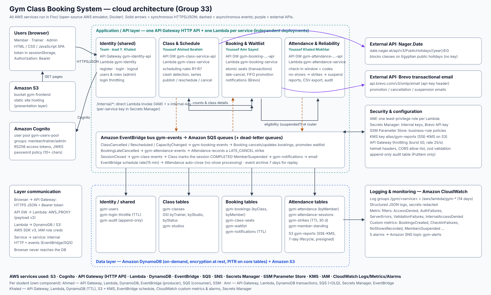

# Gym Class Booking System — Group 33

Cloud Computing & Cloud Security (26CSCN29H), British University in Egypt.

A gym website where **members** book classes and join waitlists, **trainers** schedule classes and take attendance, and **admins** manage users, reports and the audit log. It is built the way the labs build the Cloud Issue Tracker:

- HTML/CSS/JS frontend;
- Express REST API with routes, controllers and services;
- DynamoDB;
- Lambda + API Gateway + S3 on **Floci**.

| Student | ID | Owns (folder in this repository) | Branch | Personal repository (proof of work) |
|---|---|---|---|---|
| Youssef Ahmed Ibrahim | 241764 | Class & Schedule service `services/class-service/` | `youssef-ahmed` | [gym-class-service](https://github.com/youssef241764/gym-class-service) |
| Youssef Amr Sayed | 248183 | Booking & Waitlist service `services/booking-service/`, `frontend/js/views/bookings.js` | `youssef-amr` | [gym-booking-service](https://github.com/youssefamr-22/gym-booking-service) |
| Youssef Khaled Mokhtar | 245609 | Attendance & Reliability service `services/attendance-service/`, identity service `services/identity/`, `frontend/js/views/attendance.js`, `auth.js`, `admin.js` | `youssef-khaled` | [gym-attendance-service](https://github.com/MOFOYOZO/gym-attendance-service) |
| Team | | Website shell, `gym-shared` library, Floci infrastructure scripts, docs, tests | `main` | |

Following the final-submission announcement, **this one repository holds all the team's work**. Each student commits his own part on **his own branch** and opens a pull request into `main`, so the history shows who wrote what. Each student also keeps a **personal repository** with his service as proof of individual work. Every service deploys on its own (`bash infra/deploy-backend.sh <service>`).



## Folder structure

```
gym-class-booking/
├── frontend/                  website (Labs 1, 2, 5)
│   ├── index.html  css/style.css  img/
│   ├── js/config.js           picks the API: port 8080 = your PC, port 4566 = Floci
│   ├── js/api.js  js/app.js  js/ui.js  js/views/*.js
│   └── package.json           npm start -> http://localhost:8080
├── services/                  one backend per student, each its OWN repository (like the lab's backend/)
│   └── booking-service/
│       ├── app.js             builds the Express app (no listen)
│       ├── server.js          npm run dev -> your PC
│       ├── lambda.js          the same app on Lambda (handler: lambda.handler)
│       ├── routes/            method + path + who may call it
│       ├── controllers/       read request, validate, call services, choose status code
│       ├── services/          data (DynamoDB) and business rules
│       ├── workers.js         SQS messages and scheduled jobs
│       ├── events/            saved Lambda test events (Lab 7, Part 6)
│       ├── requests.http      REST Client tests on your PC (Lab 4)
│       ├── infra/             this service's IAM policy, API Gateway routes, SSM business rules
│       ├── .env.example       settings to copy into .env (never commit .env)
│       └── package.json       npm run dev | npm run zip -> lambda.zip | npm run events
├── shared/                    gym-shared: auth (Cognito JWT), logging, audit, rate limit, events
├── infra/
│   ├── floci/docker-compose.yml
│   ├── iam/trust-policy.json  dynamodb/  s3/  eventbridge/  cognito/   (JSON and text inputs)
│   ├── services/_lib.sh + 01-...sh to 09-...sh   one script per AWS service (Lab 8)
│   ├── setup-all.sh  deploy-backend.sh  deploy-frontend.sh  check-deployment.sh
│   ├── invoke-events.sh  reset-data.sh  gym-vars.sh  write-env.sh
│   └── local/                 no-Docker preview emulator, run-all.mjs
├── docs/                      architecture, API contract, test plan, deployment, security, .http tests
├── evidence/                  screenshots (list in evidence/README.md)
└── tests/                     integration (59), security (27), monitoring evidence, results/
```

## 0. Get the code

```bash
git clone https://github.com/youssef241764/gym-class-booking.git
cd gym-class-booking
```

## 1. Install (once)

Install these:

- **Node.js 20+** (`node -v`)
- **Git**, plus **Git Bash** on Windows
- **AWS CLI v2** (`aws --version`): on macOS run `brew install awscli`, on Windows use the MSI
- **Docker Desktop** (`docker version`)
- VS Code with the **REST Client** extension

Then, from the project folder:

```bash
npm run install-all
```

## 2. Start Floci and build everything

Use Git Bash on Windows or Terminal on macOS, in the project folder:

```bash
docker compose -f infra/floci/docker-compose.yml up -d
source infra/services/_lib.sh                  # dummy keys + the "awsl" command
awsl sts get-caller-identity --query Account --output text   # -> 000000000000
bash infra/setup-all.sh                        # tables, Cognito, S3, SQS, EventBridge, IAM, alarms + demo data
```

Floci Dash is at **http://localhost:4566/_floci/ui**. You can do every step there too (Way A).

The demo users' passwords are printed at the end of `setup-all.sh` and kept in `infra/.generated/seed-credentials.txt`, which is git-ignored:

| E-mail | Role |
|---|---|
| admin@gym.local | admin |
| sara.trainer@gym.local, omar.trainer@gym.local | trainer |
| ali.member@gym.local, nour.member@gym.local, hana.member@gym.local | member |

## 3a. Run on your PC (Labs 4 and 5)

Open one terminal per service, plus one for the website:

```bash
cd services/identity && npm run dev            # :3001
cd services/class-service && npm run dev       # :3002
cd services/booking-service && npm run dev     # :3003
cd services/attendance-service && npm run dev  # :3004
cd frontend && npm start                       # http://localhost:8080
```

Shortcut: `npm run local` starts all five in one terminal.

## 3b. Deploy to Floci (Labs 7 and 8)

One command does all of it: **`npm run cloud`** (stops the preview, starts Floci, runs the setup, deploys the 4 backends and the website, then runs the checks). Or step by step:

```bash
bash infra/deploy-backend.sh booking-service   # each owner deploys their own service ("all" = all four)
bash infra/deploy-frontend.sh                  # website -> s3://gym-frontend
bash infra/check-deployment.sh                 # -> Result: N passed, 0 failed
```

Open **http://localhost:4566/gym-frontend/index.html**. The footer shows *API online: lambda (production)*.

All the steps, with the AWS CLI commands each script runs, are in [docs/deployment.md](docs/deployment.md).

## No Docker? Preview mode

Floci needs Docker. Without it you can still run and demo the app on your PC with a small Python AWS emulator (moto) on the same port:

One command does all of it: **`npm run preview`** (stops old runs, installs, starts the emulator, runs the setup, starts the app). Or step by step:

```bash
sh infra/local/start-emulator.sh    # terminal 1 - keep it open (first run also installs moto + an AWS CLI copy)
bash infra/setup-all.sh             # terminal 2
npm run local                       # -> http://localhost:8080
```

Lambda needs Docker, so in preview mode you use step 3a. The graded deployment is Floci (step 3b).

In VS Code, **Terminal › Run Build Task** (⇧⌘B on Mac, Ctrl+Shift+B on Windows) does it all in one go: it stops old runs, runs `npm run install-all`, then starts the emulator, runs the setup and starts the app. No Homebrew or AWS CLI install is needed for preview mode.

## Tests

| What | Command |
|---|---|
| Saved Lambda events, on your PC | `cd services/<service> && npm run events` |
| Saved Lambda events, on Floci | `bash infra/invoke-events.sh <service>` |
| REST Client | `services/<service>/requests.http` (PC), `docs/aws-api-tests.http` (Floci) |
| Integration, 59 cases | `npm run test:integration` (see [docs/api-test-plan.md](docs/api-test-plan.md)) |
| Security, 27 cases | `npm run test:security` (`GYM_TARGET=floci` for the cloud) |
| End-to-end on the deployed system (Floci, real time) | `npm run test:e2e:floci` (~1 min) or `npm run test:e2e:floci:live` (~18 min, includes the real check-in window) |
| Monitoring evidence | `npm run evidence:monitoring` → `tests/results/monitoring-evidence.md` |

## Individual ownership

Each service is its own repository with its own `package.json`, `.env.example`, events, `requests.http`, IAM policy (`infra/iam-policy.json`) and API routes (`infra/api-routes.txt`). Only its owner commits to it, and it deploys on its own with `bash infra/deploy-backend.sh <service>`. In the shared website, each owner commits his own view file in `frontend/js/views/`.

## Documents

- [docs/architecture.md](docs/architecture.md): goal, scope, request flow, trust boundaries, cloud services, why Lambda, shared responsibility
- [docs/api-contract.md](docs/api-contract.md): every endpoint, its roles, status codes and error format
- [docs/api-test-plan.md](docs/api-test-plan.md): test levels, expected results, latest results
- [docs/deployment.md](docs/deployment.md): Floci deployment, Way A and Way B, plus the record to fill in
- [docs/security.md](docs/security.md): every security control, where it lives and how to prove it
- [evidence/README.md](evidence/README.md): the screenshots to take

## Never commit

`.env`, `infra/.generated/` (IDs and demo passwords), `node_modules/`, `lambda.zip`. The `.gitignore` handles them. Real keys, such as the Brevo key, go in Secrets Manager only:

```bash
BREVO_API_KEY=xkeysib-... bash infra/services/01-kms-secrets-ssm.sh
```
