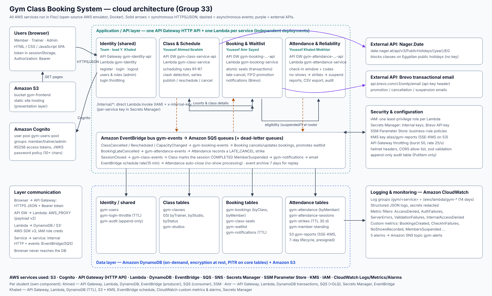
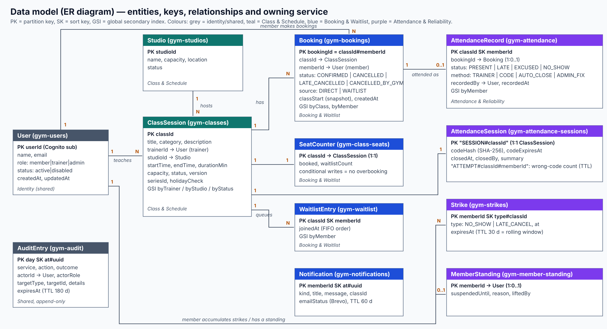

# Gym Class Booking System — Architecture

Group 33 · Cloud Computing & Cloud Security (26CSCN29H). This document uses the Lab 3 headings, then shows the cloud view from Labs 7 and 8.



## 1. Application Goal

A gym needs one place where **members** book classes, **trainers** run them, and **admins** manage everything. Today this is done with phone calls and paper lists, which leads to over-booked classes, no-shows nobody tracks, and no proof of attendance.

The system gives each role a website backed by a real cloud API and database:

- **Members** see the timetable with live places, book, join a waitlist, cancel and check in.
- **Trainers** schedule classes within the gym's rules, take attendance and see reports.
- **Admins** manage users, roles, studios, corrections and the audit log.

## 2. Functional Scope

Three student-owned services, plus a shared identity service. Each has at least three related functions.

| Service | Owner | Functions |
|---|---|---|
| **Class & Schedule** (`class-service`) | Youssef Ahmed Ibrahim, 241764 | F1 create a class checked against 7 scheduling rules (incl. public holidays from Nager.Date) · F2 weekly recurring series · F3 reschedule / publish with version check · F4 cancel with event cascade · F5 timetable with live availability |
| **Booking & Waitlist** (`booking-service`) | Youssef Amr Sayed, 248183 | F1 book a seat atomically · F2 cancel with late-cancel policy and automatic waitlist promotion · F3 waitlist join / leave / position · F4 my bookings and class roster · F5 notifications (in the app + Brevo e-mail) |
| **Attendance & Reliability** (`attendance-service`) | Youssef Khaled Mokhtar, 245609 | F1 attendance sheet · F2 one-time check-in code · F3 close the session → no-shows → strikes · F4 strike / suspension policy with admin lift and correction · F5 reports, encrypted CSV export and audit viewer |
| **Identity** (`identity`, shared) | Team | register, sign in / out, user search, role change and disable (Cognito) |

**Roles:** `member`, `trainer` and `admin`. They are enforced in the backend on every request; hiding a button is not access control.

**External APIs:** Nager.Date (public holidays, used in scheduling rule R7) and Brevo (transactional e-mail).

## 3. Request Flow

**BOOK A CLASS** (the main flow, crossing all three services)

```
Member → Timetable "Book" → POST /api/bookings ──▶ API Gateway ──▶ Lambda gym-booking-service
                                                     │ 1. verify the Cognito token, role = member
                                                     │ 2. validate {classId}
                                                     │ 3. invoke gym-class-service   → class is PUBLISHED, not started
                                                     │ 4. invoke gym-attendance-service → member not suspended
                                                     │ 5. DynamoDB transaction: seat counter + booking row
       ◀── render "Booked" ◀── 201 + booking JSON ◀──┘ 6. audit line, log line
```

- The member clicks **Book**, and the website sends `POST /api/bookings` with `{"classId": "…"}` and the access token.
- The booking service checks the token, then the data, then asks the class service whether the class is bookable and the attendance service whether the member is suspended.
- Seat and booking are written in **one DynamoDB transaction**, so two members can never take the last seat at the same time.
- On success the answer is **201** with the booking. Problems answer 400, 401, 403 `MEMBER_SUSPENDED` or 409 `CLASS_FULL`.

**CANCEL A CLASS** (asynchronous, events)

```
Trainer → POST /api/classes/{id}/cancel → class-service → 200
                     └── event ClassCancelled → EventBridge gym-events → SQS gym-booking-events
                                   → booking-service: cancel bookings, notify members (in the app + Brevo)
```

**CLOSE A SESSION**

```
Trainer → POST /api/attendance/{id}/close → attendance-service: unmarked members become NO_SHOW → strike
   └── 3 strikes in 30 days → suspended 7 days → event MemberSuspended → notification
   └── event SessionClosed → class-service marks the class COMPLETED
```

If a trainer forgets to close a session, an EventBridge schedule (every 15 minutes) closes it automatically.

## 4. Trust Boundaries

```
USER-CONTROLLED SIDE                            APPLICATION-CONTROLLED SIDE
Browser input ── HTTPS request ──▶ API Gateway ──▶ Lambda (Express API) ──▶ DynamoDB, S3, SQS, ...
     ▲                                                     │
     └──────────────── JSON response ◀─────────────────────┘
```

1. **The API validates every request** with strict schemas, and unknown fields are rejected. Checks in the browser are only a convenience.
2. **Who you are** comes only from the Cognito token. It is RS256-signed and checked against the user pool's public keys. **Your role** comes from the token's `cognito:groups` claim, never from the body.
3. **Ownership** is checked on the server. A member can only cancel their own booking, and a trainer can only manage their own classes (no IDOR).
4. **The browser never talks to the database** or to another service. `/internal/*` routes are not in API Gateway at all.
5. **Errors never leak** internals. 500 answers are generic; the details go to CloudWatch Logs with a request id.
6. **The frontend shows text as text** (`textContent`, never `innerHTML`). Its Content-Security-Policy allows only its own scripts.

A second boundary sits **between the services**. Each one trusts another only if:

- its IAM role may invoke that function, and
- it presents that service's secret key (`x-internal-key`, stored in Secrets Manager).

## 5. Cloud Architecture on Floci (Labs 7 and 8)

| Layer | AWS service | Name(s) | Why |
|---|---|---|---|
| Website | **S3** | `gym-frontend` | Static files, public read only (`infra/s3/frontend-public-read-policy.json`) |
| Sign-in | **Cognito** | `gym-users-pool`, client `gym-web`, groups | Managed passwords (10+ chars), signed tokens, roles as groups |
| API | **API Gateway** (HTTP API) | `gym-<service>-api`, explicit routes, stage `$default` | One public address per service; unknown routes are stopped before Lambda |
| Compute | **Lambda** (Node.js 24) | `gym-identity`, `gym-class-service`, `gym-booking-service`, `gym-attendance-service` | Same Express app as on the PC (`app.js` + `lambda.js`); pay per request |
| Data | **DynamoDB** | 13 `gym-*` tables (`infra/dynamodb/tables/`) | Persistent; transactions for seats; TTL; point-in-time recovery |
| Permissions | **IAM** | `gym-<service>-role` + `gym-<service>-access` | Least privilege: each role reaches only its own tables, queues and keys |
| Messaging | **EventBridge** + **SQS** (+ DLQ) | bus `gym-events`, 4 rules, 4 queues | Services react to each other without waiting; failed messages go to a DLQ |
| Secrets | **Secrets Manager** | `gym/<service>/internal-key`, `gym/booking-service/brevo-api-key` | No secret in code or files |
| Config | **SSM Parameter Store** | `/gym/<service>/policy` | Business rules can change without redeploying |
| Encryption | **KMS** | `alias/gym-reports` | CSV exports in `gym-reports` are encrypted (SSE-KMS) |
| Monitoring | **CloudWatch** Logs, metric filters, alarms → **SNS** | `/aws/lambda/gym-*`, 5 alarms, topic `gym-alerts` | See attacks (403 spikes, failed logins) and errors |

### Why Lambda and not EC2?

EC2 means renting whole servers that we must patch, size and pay for every hour, even at night when nobody books a class.

Lambda runs our code only when a request arrives and costs nothing when idle. Each service also scales on its own: the timetable gets far more reads than the attendance page.

That suits a gym's traffic, with short peaks before classes and quiet hours in between.

### Shared responsibility

| AWS (here: Floci plays AWS) | Us |
|---|---|
| Physical servers, network, the Lambda runtime, DynamoDB storage and replication, Cognito's password storage | Our code and its dependencies, input validation, IAM policies (least privilege), CORS, which bucket is public, secrets in Secrets Manager (not in code), logging without personal data, our data model |

## 6. Two Ways to Run the Same Code

| | On your PC (Labs 4 and 5) | On Floci (Labs 7 and 8) |
|---|---|---|
| API | `npm run dev` → `server.js` → `app.js` on ports 3001–3004 | Lambda → `lambda.js` → the same `app.js` |
| Website | `cd frontend && npm start` → `http://localhost:8080` | S3 → `http://localhost:4566/gym-frontend/index.html` |
| Which API the page calls | `frontend/js/config.js` sees port 8080 → `localhost:300x` | `frontend/js/config.js` sees port 4566 → the API Gateway URLs |
| Service-to-service | HTTP to `localhost:300x` | Direct Lambda invoke (IAM-controlled) |
| Background work | Workers poll SQS every few seconds | SQS event source mappings + EventBridge schedule |
| AWS resources | Floci (or the no-Docker preview emulator) | Floci |

## 7. Data Model



Each service owns its tables, and no service reads another service's tables:

- **identity:** `gym-users`, `gym-login-throttle`
- **class-service:** `gym-classes`, `gym-studios`
- **booking-service:** `gym-bookings`, `gym-class-seats`, `gym-waitlist`, `gym-notifications`
- **attendance-service:** `gym-attendance`, `gym-attendance-sessions`, `gym-strikes`, `gym-member-standing`

The one shared table, `gym-audit`, is append-only: the IAM policies allow `PutItem` but not update or delete.
